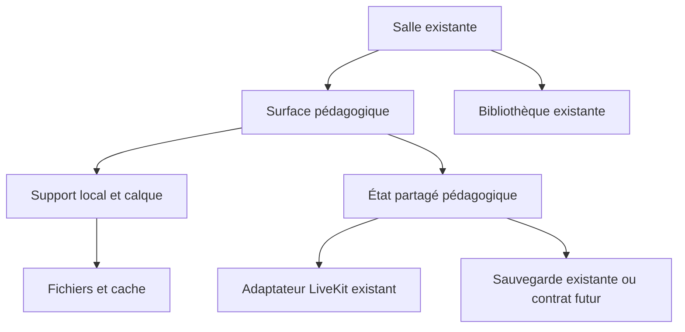

# Rewayah - Supports, tableau et annotations en classe

Version : V2. Date : 1 octobre 2026.

Statut : spécification consolidée des décisions du directeur ; ne constitue pas une preuve de livraison. Remplace la V1 pour ce module. Le présent document est autonome et destiné au handoff Claude.

**Objet : compléter la classe existante, préserver ses visuels et rendre le partage pédagogique simple, fiable et accessible.**

Ce document fixe un plan de conception et de livraison. Les choix déjà décidés par le directeur sont conservés. Les décisions UX récentes sont intégrées dans les sections 4, 6 et 17 à 23. Les paramètres nouveaux d’exécution sont identifiés comme prescriptions de cette spec, sans les présenter comme des décisions historiques ou des fonctionnalités livrées. Aucun code applicatif, serveur ou déploiement n'est modifié par ce travail.

## 1. Décisions acquises et limites de preuve

| Sujet | Référence retenue |
|---|---|
| Classe existante | Le directeur confirme que ses visuels sont déjà implémentés pour toutes les parties. Ils sont la base du travail. |
| Méthode | Garder l'existant utile, améliorer seulement les éléments concernés. Aucune reprise générale. |
| Partage | Affichage natif local des supports, sans vidéo du document. LiveKit conserve l'audio et la vidéo des personnes. |
| Autorité | L'enseignant dirige automatiquement support, page et affichage. Aucun bouton « Suivre l'enseignant ». |
| Annotation | Calque transparent au-dessus du support, solidaire de ses coordonnées. Source originale immuable. |
| Affichages | Support seul, tableau seul, support avec annotations. Masquer ne supprime rien. |
| Direct | Événements pédagogiques par LiveKit Data Channels. Pas de points de dessin écrits en base. |
| Style | Tokens existants gelés, DM Sans pour les titres français, Plus Jakarta Sans pour les autres textes latins. Polices arabes existantes préservées. |
| Terminologie | Classe, séance, Sayyid/Sayyida, Interface guidée, Séance en direct. Pas de codes techniques visibles. |
| Périmètre actuel | Conception et frontend. Les contrats temps réel et durables sont décrits pour préparer les étapes futures, sans autoriser une refonte backend. |

**Divergence de stockage :** le prompt récent cite Supabase Storage ; les sources canoniques utilisent R2 pour les ressources. Le plan conserve un adaptateur de fichiers indépendant du fournisseur. Il ne lance aucune migration et ne crée pas un second stockage. Le fournisseur effectivement branché doit être relevé dans le dépôt avant toute livraison réseau.

**Preuve visuelle :** l'image jointe « Classe Details » montre une fiche tuteur avant/après séance, pas la salle en direct. Le dossier du 24 septembre est antérieur à l'état confirmé aujourd'hui. Il peut aider à retrouver les composants ; il ne doit pas servir à conclure que les dernières salles sont absentes. Aucun emplacement exact en pixels n'est présenté comme vérifié sans capture actuelle.

## 2. Principe produit : une surface de travail, une bibliothèque

L'enseignant pense : « Je prends un livre, je montre une page, j'écris dessus, je cache le livre pour expliquer, puis je le reprends ou le range. »

L'élève pense : « Je vois ce que Sayyid ou Sayyida montre. Je peux agrandir pour lire. J'écris seulement quand on m'y autorise. »

La surface pédagogique existante reste au même endroit. Le panneau Bibliothèque s'ouvre dans la salle, sans changer de connexion. Un seul support est présenté à la fois. Le tableau n'est pas une autre application ni une nouvelle destination de navigation.

Deux actions ont des conséquences distinctes :

| Action | Effet sur la classe | Contenu conservé | Retour |
|---|---|---|---|
| Passer au tableau seul | Le fond du support disparaît ; les notes restent visibles | Support, page, annotations et repère | Un clic sur « Avec notes » |
| Revenir au support seul | Affiche le support en cachant les annotations | Toutes les annotations | Un clic sur « Avec notes » |
| Ranger dans la bibliothèque | Retire le support actif et remet le tableau libre au premier plan | Page et annotations du support, tableau libre indépendant | Bibliothèque > carte récente > « Présenter » |
| Quitter la séance | Utilise le parcours de sortie existant | Selon le contrat de sauvegarde réellement disponible | Parcours existant |

Le rangement n'efface pas. Le tableau libre ne récupère pas automatiquement les traits attachés au livre : cela évite de déplacer un cercle dessiné sur un mot dans un autre contexte.

## 3. Comportement du support rétractable

### Masquer temporairement

La commande « Tableau » masque le support immédiatement. Son identité reste disponible dans le panneau « Commandes » sous forme de miniature et de titre court ; ce panneau peut être replié. « Avec notes » le réaffiche à la même page avec ses annotations. La miniature est un repère, pas un bouton supplémentaire doublonnant la commande de restauration.

La feuille transparente devient une feuille claire et occupe la surface pédagogique disponible. Elle conserve son repère de page et son ratio. On peut continuer à écrire dessus. Réafficher le support fait apparaître les nouvelles notes au bon endroit.

Le tableau peut remplir visuellement le panneau par son fond clair, mais les coordonnées de la feuille ne sont jamais étirées pour remplir artificiellement un écran de forme différente. Le pan et le zoom permettent de travailler dans la feuille. Il n'y a pas de canevas infini dans ce lot.

### Ranger réellement

« Ranger dans la bibliothèque » est dans le menu du support, près de son titre. Une courte animation réduit une copie visuelle du support vers sa carte si le panneau est ouvert, sinon vers le bouton Bibliothèque. Le vrai état change indépendamment de l'animation.

L'animation ne déplace ni les commandes de visio ni les coordonnées stockées. La carte de bibliothèque affiche le point de reprise. Aucune confirmation modale pour cette action réversible. Un état discret « Support rangé » suffit lorsqu'il est utile ; aucun toast répété aux élèves.

Sur mouvement réduit, utiliser un fondu ou une transition immédiate. Le glisser-déposer est un agrément ultérieur possible sur ordinateur/tablette. Le bouton reste le parcours complet et accessible ; aucun geste obligatoire ni animation 3D.

### Remplacer un support

Choisir une carte ouvre sa prévisualisation personnelle. La classe conserve le support actuel jusqu'au clic « Présenter ». Après vérification du fichier, le nouveau support est activé atomiquement avec sa page et son état. Les annotations de l'ancien restent attachées à l'ancien.

Un fichier non chargé ne remplace jamais le support existant par une page vide. Une erreur propose « Réessayer » et « Revenir aux supports ».

## 4. Commandes : trois groupes indépendants

### 4.1 Visio, accessible sans ouvrir un panneau

La barre basse contient, dans cet ordre stable : **Micro, Caméra, Quitter**. Ce sont les commandes de base de l’appel, indépendantes de « Commandes ». Garder les composants et actions existants ; modifier leur révélation si nécessaire. Ne jamais déplacer Quitter dans un menu de support.

- Mobile/tablette tactile : toucher la surface révèle la barre basse. Aucun tap préalable sur « Commandes ».
- Web : un mouvement de souris dans la salle révèle la barre basse, sans clic.
- Clavier : prise de focus dans la salle ou navigation Tab révèle les commandes et les garde visibles tant qu’elles ont le focus.
- La révélation ne coupe pas le micro et ne quitte pas l’appel : elle rend les boutons directement utilisables. Une activation volontaire reste nécessaire.
- Le même geste doit pouvoir continuer à déplacer, zoomer ou dessiner ; pas de calque transparent qui consomme le premier geste.
- Les états réels de micro et caméra restent lisibles sur les boutons. Le témoin d’enregistrement représente l’état effectif du système.

Le comportement temporisé et les cas de priorité sont définis en section 18.

### 4.2 Partage et tableau : uniquement au clic sur « Commandes »

Un seul déclencheur « Commandes » demeure découvrable, discret et atteignable. Il ouvre le panneau pédagogique ; aucun onglet Visio n’y figure. Sur mobile : bouton près du bas, au-dessus de la zone réservée à la barre de visio, panneau temporaire. Sur desktop : déclencheur sur le bord droit de la surface, panneau droit repliable. Ne pas rendre les outils permanents parce qu’ils sont disponibles.

| Fonction | Emplacement unique dans le panneau pédagogique | Effet |
|---|---|---|
| Bibliothèque | Première action du panneau | Ouvre le catalogue dans le même emplacement |
| Support / Avec notes / Tableau | Choix groupé sous le contexte du support | Un clic change l’affichage partagé ; invisible sans support |
| Page précédente / Page suivante | Autour de « Page X sur Y » | Changement partagé, sens et noms RTL vérifiés |
| Ranger dans la bibliothèque | Menu du titre du support | Retire le support actif, conserve sa reprise |
| Pointeur | Ligne d’outils primaires | Indication temporaire sans annotation permanente |
| Écrire | Ligne d’outils primaires | Ouvre la sous-barre d’écriture |
| Stylo / Surligner / Gomme / Annuler | Sous-barre seulement après Écrire | Une seule sélection active ; gomme par trait |
| Couleur / Épaisseur | Options de l’outil actif | Choix courts, sans palette graphique professionnelle |
| Effacer les notes | Menu de la surface actuelle | Confirmation ciblée, jamais effacement silencieux |
| Ajuster à l’écran | Section Lecture, locale | Rétablit le cadrage personnel |
| Focus | Section Affichage, locale | Replie les panneaux et agrandit la surface |
| Marqueurs / Masquer des versets / Travail | Capacités existantes, sous leur entrée contextuelle | Préserver, ne pas réinventer ni les afficher toutes en permanence |

« Réduire » ferme le panneau. Sur téléphone, fermer le panneau une fois le stylo choisi laisse seulement une courte palette contextuelle : outil actif, Annuler, Terminer. Les autres outils reparaissent par « Commandes ». Ne pas cacher les outils en cours de sélection. En Interface guidée, garder pictogramme et mot.

### 4.3 Personnes et contexte

En compact pendant le partage : petit avatar statique de l’enseignant, témoin rouge d’enregistrement lorsqu’il est actif, œil du contrôle possible. Pas de nom, réseau, grande carte ou vidéo dans cette capsule. Chaque indicateur a un nom accessible et une zone tactile suffisante.

Cliquer la capsule ou l’avatar développe le contexte enseignant et les informations de séance dans leur panneau existant. Cliquer l’œil ouvre le même panneau à la section de contrôle. Les éléments retrouvent une taille normale et lisible. « Réduire » restaure l’affichage compact. Les indicateurs ne remplacent pas une alerte réseau réellement bloquante.

L’œil informe sur une capacité effective de contrôle ; il ne déclenche pas une observation et ne donne aucun droit. Distinguer « Contrôle possible » et « Contrôle actif » dans le panneau selon le contrat réel. Si la donnée manque, ne pas fabriquer l’état. Préserver les notices obligatoires, notamment celles de l’enfant observé.

Sur desktop développé, Participants occupe la colonne gauche. L’autorisation d’écrire est sur la ligne de l’élève, pas dans le menu du support. Sur mobile/focus, la capsule ouvre le panneau de personnes existant. Une seule gestion des participants, aucun deuxième roster.

## 5. Expérience élève et observateur

| Profil | Commandes présentées | Ce qui suit l'enseignant |
|---|---|---|
| Élève standard | Zoom local, ajustement, micro/caméra selon politique, participants, quitter | Support, page, affichage, annotations, focus explicite |
| Interface guidée | « Agrandir », « Voir toute la page », commandes existantes adaptées ; pictogramme + mot | Identique, sans étape de consentement au suivi |
| Élève autorisé à écrire | Barre courte « Stylo », « Gomme », « Annuler », « Terminer » | Support et page restent dirigés |
| Tuteur observateur | Commandes d'observation existantes ; zoom de consultation si déjà prévu | Présentation en lecture seule |
| Contrôleur/admin observateur | Interface du rôle et règles existantes | Lecture seule pour ce module |

L'élève ne voit ni le menu de rangement ni les trois modes de présentation. Il ne change pas la page partagée et ne lance pas un support personnel pendant une présentation dirigée. Une bibliothèque de révision hors séance reste indépendante.

L'autorisation d'écrire est explicite. Le texte enfant est « Tu peux écrire sur le tableau. » Le texte adulte est « Vous pouvez écrire sur le tableau. » L'élève entre dans Écrire volontairement ; ses gestes de lecture ne deviennent pas soudain des traits.

L'enseignant conserve les droits de page, de support, d'effacement global et de présentation. L'autorisation de dessiner ne délègue aucun de ces droits. Quand la page change ou le droit est retiré, terminer le trait selon la règle de révision et désactiver le dessin au bon endroit.

Les quotas, annonces de présence et notices d'observation existants sont préservés. Ce plan ne les redéfinit pas. Le libellé interdit « Cours en cours » n'est pas réintroduit : utiliser « Séance en direct ».

## 6. Layout responsive final

| Format / état | Gauche | Centre | Droite | Bas |
|---|---|---|---|---|
| Mobile immersif | Aucun panneau permanent | Support ou tableau occupant la surface disponible ; capsule compacte en haut | Aucun panneau permanent | Déclencheur Commandes discret ; visio masquée hors interaction |
| Mobile au toucher | Identique | Contenu conservé | Identique | Micro, Caméra, Quitter révélés directement |
| Mobile Commandes | Identique | Contenu visible au-dessus ou derrière la sheet | Sheet pédagogique temporaire | Visio indépendante, accessible au toucher |
| Mobile focus | Aucun panneau, aucune grande vidéo | Contenu agrandi, capsule minimale | Commandes fermées mais déclencheur accessible | Visio révélable au toucher ; sortie du focus accessible |
| Tablette développée | Participants si la largeur réelle suffit | Surface dominante | Panneau pédagogique temporaire | Visio stable quand révélée |
| Web développé | Participants compact, états micro et droits d’écriture | Support dominant et lisible | Commandes pédagogiques si ouvertes | Visio révélée par mouvement de souris |
| Web immersif / focus | Colonne repliée | Surface sur toute la largeur utile, capsule minimale | Colonne repliée, déclencheur Commandes | Visio révélée par mouvement de souris, jamais supprimée |
| Web bibliothèque | Participants conservés si largeur suffisante | Présentation actuelle maintenue | Catalogue remplace le contenu du panneau droit | Visio indépendante |

**Le desktop développé doit être équilibré.** La colonne gauche contient les participants et les états utiles, inspirés du shell déjà implémenté. Aucun panneau vide ou décoration pour combler la largeur. Les outils à droite restent conditionnels au clic sur Commandes. Le focus replie les deux côtés ; ne pas reproduire la version desktop surchargée.

« Toute la surface » ne signifie pas déformer la page : préserver son ratio, hors marges de placement, avec zoom et déplacement locaux. Ne pas recouvrir les mots par les panneaux. Garder les SafeArea, les commandes système et la visibilité du navigateur. Le focus applicatif ne requiert pas le plein écran navigateur.

Les breakpoints existants priment. Si deux colonnes rendent le support illisible, basculer les panneaux en présentation temporaire plutôt que comprimer le texte. Ne pas imposer des largeurs en pixels à toutes les fenêtres. Sur tablette au stylet, préserver la zone d’écriture et traiter le doigt selon le mode actif.

Accessibilité : cibles d’au moins 48 dp, même pour l’avatar et l’œil ; libellés sémantiques ; contraste AA ; texte d’interface à 200 % ; focus visible ; état non porté par la couleur seule. Les éléments masqués sortent de l’ordre de focus, mais un parcours clavier permet de révéler la barre. Le masquage automatique est désactivé tant que l’utilisateur navigue au clavier, qu’un lecteur d’écran est actif ou qu’une interaction de contrôle est en cours.

Le Mushaf n’est pas inversé en sombre. Tableau seul : fond clair et encre lisible. Le chrome utilise exclusivement les tokens existants. DM Sans pour les titres français, Plus Jakarta Sans pour les autres textes latins, police arabe du projet conservée. Pas de nouveaux tokens inventés dans les widgets.

Rangement animé court, 180 à 250 ms comme point de départ à mesurer ; mouvement réduit : fondu ou changement immédiat. Enregistrement actif : pulsation douce et lente, sans flash ni passage à l’invisibilité ; témoin fixe si mouvement réduit. Aucun état métier ne dépend d’une animation.

## 7. Gestes, lecture et dessin

- Avec stylet détecté : stylet pour l'encre lorsque Écrire est actif ; doigt pour déplacement/zoom. La disponibilité de pression et de rejet de paume dépend du matériel et du navigateur : ne pas la promettre partout.
- Sans stylet : un doigt dessine uniquement en mode Écrire ; deux doigts déplacent/zoomment. En mode lecture, un doigt peut déplacer la page.
- Souris : clic et glisser selon l'outil actif ; zoom via les contrôles existants et geste supporté. Aucun raccourci ne remplace une commande visible.
- Ne pas activer le changement de page par balayage au milieu d'un trait ou d'un déplacement d'image. Les boutons de page restent disponibles.
- « Annuler » retire la dernière opération personnelle validée sur la surface actuelle. Ne pas restaurer un vieux snapshot qui supprimerait le travail d'un autre élève.
- La gomme du premier lot retire des traits identifiés, pas des pixels. La gomme partielle n'est pas nécessaire pour enseigner.

## 8. Architecture minimale à intégrer

Ces boîtes décrivent des responsabilités ; elles ne prescrivent pas six nouveaux packages, services ou providers. Réutiliser les responsabilités déjà présentes avant d'ajouter un fichier.

| Responsabilité | Contenu | À éviter |
|---|---|---|
| Salle | Connexion, personnes, audio/vidéo, notices, sortie | Nouveau client LiveKit ou nouvelle salle parallèle |
| Catalogue | Ressources autorisées, couvertures, recherche, versions | Deuxième bibliothèque pour le tableau |
| Surface | Support, calques, clipping, zoom, modes | Page de tableau indépendante avec sa propre connexion |
| État partagé | Support/page/vue, traits validés, droits et révision | Dépendre uniquement de widgets montés à l'écran |
| Adaptateur direct | Sérialisation, envoi/réception, contrôle d'identité, récupération | Réécrire le cœur WebRTC |
| Fichiers/cache | Chargement versionné, préchargement borné, erreurs | Choisir un fournisseur dans chaque widget |
| Sauvegarde | Instantané compact via le mécanisme autorisé | Écrire chaque point en base ou annoncer une sauvegarde inexistante |

### Trois états indépendants

1. **Partagé :** séance, auteur enseignant, support/version/page, mode d'affichage, contexte de dessin, révision, permissions et traits validés.
2. **Local :** panneau ouvert, focus clavier, zoom de lecture, position du dock si déjà personnalisable, prévisualisation non présentée.
3. **Durable :** reprise et annotations sauvegardées selon la politique existante. Une action réseau réussie ne prouve pas une sauvegarde durable.

Un zoom local différent ne change pas la référence du trait. Un focus dirigé par l'enseignant change le point pédagogique commun ; chaque appareil conserve une taille de lecture adaptée. Ne pas recopier une matrice de zoom iPad brute sur un téléphone.

## 9. Géométrie : garantie de placement

Le repère est la page/version de référence, jamais le Stack extérieur ou la fenêtre. Conserver ses dimensions canoniques et son ratio.

1. Calculer le rectangle réel de l'image après le placement `BoxFit.contain`.
2. Convertir le point tactile dans le repère du contenu par la transformation inverse du zoom et du déplacement.
3. Retirer l'offset de placement, puis normaliser dans la page réelle : `u = x / largeur_page`, `v = y / hauteur_page`.
4. Rejeter les gestes hors de la surface autorisée. Ne pas rabattre tous les gestes de marge sur le bord.
5. Générer le contour perfect_freehand dans le repère canonique, puis transformer ensemble image et encre vers l'écran.
6. Conserver pression, épaisseur canonique et options de l'outil avec le trait. Même version de l'algorithme sur les clients.

La taille des boutons reste indépendante du zoom. L'épaisseur de l'annotation suit la page ; les poignées d'interface gardent une taille tactile.

Un changement d'orientation recalcule l'affichage, pas les traits stockés. Une nouvelle résolution d'image doit préserver exactement cadrage et géométrie de page.

**Limite essentielle :** les coordonnées de page ne suivent pas des mots dans un texte reflowable. Le mode verset agrandi existant n'est pas supprimé. Dans ce lot, ne pas projeter ses annotations libres par simple normalisation : utiliser les marqueurs sémantiques existants, ou proposer une vue agrandie de la page fixe. Aucun moteur nouveau de reconnaissance de mots n'est requis.

## 10. Protocole temps réel minimal

Data Channels : parler de lossy/reliable, pas de bascule UDP/TCP. Le reliable est ordonné et retransmis, mais ne garantit pas la réception après une déconnexion et ne conserve pas un historique serveur.

| Message logique | Livraison | Règle |
|---|---|---|
| Présentation : support/page/vue | Reliable | Un état compact cohérent ; application atomique à une révision |
| Aperçu de trait / pointeur | Lossy | Envoi groupé au maximum toutes les 40 ms pendant le geste ; numéros de lots |
| Trait terminé | Reliable | Tracé complet compact ; découpage si nécessaire ; remplace l'aperçu |
| Retirer trait / annuler / effacer | Reliable | Identifiants ciblés, révision et déduplication |
| Autorisation d'annoter | Reliable pour l'annonce | Doit provenir de l'autorité effective ; le message ne crée pas à lui seul un droit serveur |
| Demande d'état / état complet | Reliable | Réponse ciblée au participant ; snapshot puis opérations plus récentes |

Enveloppe minimale : version de protocole, identifiant de séance, contexte de présentation, support/version/page ou tableau, identifiant d'opération, auteur issu de la connexion, révision, données.

Ne pas ajouter un champ redondant sans besoin. Réutiliser les DTO existants. Le contexte de présentation doit empêcher un ancien paquet de repeindre une page différente ou une page revisitée après effacement.

### Fiabilité utile, sans moteur distribué généraliste

- Capturer les points à la cadence locale ; grouper les envois, sans jeter tous les points intermédiaires.
- Viser des paquets lossy d'environ 1 200 octets, sous la recommandation de 1 300 ; reliable au plus 15 Kio de charge utile. Prévoir découpage et assemblage bornés.
- Rendre immédiatement sur l'appareil de l'auteur ; les destinataires utilisent l'aperçu puis la version finale.
- Identifier les traits par auteur et identifiant unique ; ignorer les doublons et les lots anciens.
- L'enseignant arbitre les opérations durables et attribue la révision commune. En cas de trou détecté, demander l'état au lieu de deviner.
- À la reconnexion, suspendre l'écriture jusqu'à récupération du contexte courant. Le snapshot indique sa révision ; appliquer ensuite les opérations postérieures, pas les anciennes.
- Limiter taille de trait, nombre de traits, fréquence et données entrantes. Un client autorisé peut aussi envoyer un message malformé.
- Donner la priorité aux changements pédagogiques sur les aperçus et snapshots volumineux. Bornage des files, pas de rafale infinie de messages après coupure.

L'enseignant qui perd le réseau continue éventuellement son explication orale selon la connexion média effective, mais son écran ne doit pas laisser croire que chaque nouvelle annotation est partagée. Afficher l'état de synchronisation. Les nouveaux traits locaux restent identifiés comme non partagés jusqu'à réconciliation.

## 11. Sauvegarde, fichiers et cache

**Séparer transport et conservation.** « Supabase ne transporte pas le direct » est compatible avec une sauvegarde occasionnelle d'un instantané, si elle est autorisée. Sans sauvegarde durable, la fermeture de tous les clients peut perdre les notes : le document ne promet pas leur retour à la séance suivante.

Le rangement conserve l'état dans la séance même si une sauvegarde distante n'est pas disponible. Une conservation au prochain cours exige le contrat durable existant, ou une étape backend explicitement autorisée. Si ce contrat manque, c'est une dépendance de livraison, pas un prétexte pour refondre le serveur.

Recommandation future : instantané compact après opérations stabilisées, changement de support/rangement et fin de séance, avec regroupement des écritures. Ne pas attendre uniquement la fermeture d'un onglet pour sauver. La politique de partage et de conservation des annotations doit reprendre celle des ressources pédagogiques existantes ; ne pas publier des notes privées dans un support global.

Fichiers : pages immuables et versionnées, source/licence vérifiées, édition Hafs conforme au référentiel. Pas de Mushaf composé approximativement ni d'image générée. Les images ne remplacent pas le texte structuré requis pour la navigation par sourate/verset et l'accessibilité.

Cache : page actuelle et quelques pages voisines, borné en mémoire et sur disque. Ne pas décoder tout le Mushaf au démarrage. Une image HD légère sur le réseau peut occuper beaucoup de mémoire une fois décodée. Choisir des résolutions adaptées à la taille d'écran et au zoom, en conservant le même cadrage. Favoriser une compression préservant les petits signes après contrôle visuel, pas le plus petit WebP à tout prix.

Web : cache navigateur configuré, CORS correct, comportement des URL signées vérifié. `cached_network_image` seul ne garantit pas le cache persistant Web. Ne pas exposer des fichiers privés pour faciliter le cache ; le statut public d'une ressource dépend de sa politique et de sa licence.

Supprimer les caches concernés lors d'un retrait d'accès selon les règles existantes. Les PDF éventuels restent des dérivés versionnés, pas une nouvelle génération à chaque lecture.

## 12. États UI et textes utiles

| État | Enseignant | Élève | Commandes |
|---|---|---|---|
| Aucun support | « Choisissez un support ou écrivez au tableau. » | Tableau visible, sans instruction technique | Bibliothèque, Écrire côté enseignant |
| Recherche catalogue vide | « Aucun support ne correspond à votre recherche. » | Non affiché | Effacer la recherche |
| Chargement avant présentation | « Ouverture du support… » dans le panneau | Présentation actuelle conservée | Revenir aux supports |
| Présentation en chargement côté élève | État discret du destinataire si utile | « Le support arrive… » | Audio maintenu ; dernier contenu marqué comme en attente |
| Ressource indisponible | « Ce support ne peut pas être ouvert. » | « Le support ne s'affiche pas. » | Réessayer sans quitter la séance |
| Tableau seul avec support retenu | Miniature, titre, choix « Tableau » actif | Feuille et annotations | Avec notes côté enseignant |
| Autorisation de dessin | Élève et droit visibles dans Participants | « Tu peux écrire sur le tableau. » ou variante adulte | Écrire, Terminer |
| Droit retiré | État mis à jour dans Participants | « Sayyid reprend le tableau. » ou « Sayyida reprend le tableau. » | Outils de dessin retirés |
| Synchronisation interrompue | « Vos nouvelles notes ne sont pas partagées. » | « Le tableau se reconnecte. » | Lecture locale possible ; écriture distante suspendue |
| Récupération d'état | « Reprise du tableau… » | « Le tableau revient. » | Aucune sélection manuelle de version |
| Effacement de page | « Effacer toutes les notes de cette page ? » | Pas de dialogue | Annuler / Effacer les notes |
| Effacement du tableau libre | « Effacer toutes les notes du tableau ? » | Pas de dialogue | Annuler / Effacer les notes |
| Sauvegarde en échec | « Les notes de cette séance ne sont pas sauvegardées. » | Pas d'alerte inutile | Réessayer si le contrat durable existe |

Ne pas afficher « Sauvegardé » quand seul un envoi LiveKit a réussi. Ne pas transformer l'arrivée de chaque trait en notification. Les erreurs de panneau n'arrêtent pas l'audio et les notifications ne masquent pas les versets.

## 13. Erreurs à éviter et prévention de l'overengineering

| Erreur | Conséquence | Prévention minimale |
|---|---|---|
| Refaire la salle pour ajouter le tableau | Régression des parcours validés | Diff local et captures avant/après |
| Créer deux bibliothèques ou deux docks | Confusion et maintenance doublée | Une source et une commande canonique |
| Dessiner sur les pixels de l'écran | Décalage entre appareils | Coordonnées de page et transformation commune |
| Recalculer le contour du trait en pixels locaux | Épaisseur/lissage différents | Géométrie canonique puis transformation |
| Réduire l'image sans son calque | Notes flottantes | Support et notes dans le même repère |
| Reflow sans ancrage sémantique | Cercle sur le mauvais mot | Limiter l'encre libre aux pages fixes |
| Unreliable pour la seule version d'un trait | Dessins incomplets | Aperçu lossy + commit reliable |
| Reliable assimilé à sauvegarde | Perte après coupure | Snapshot, révisions et contrat durable distinct |
| Ancien trait reçu sur une nouvelle page | Annotation incorrecte | Contexte de présentation et déduplication |
| Effacer/annuler par remplacement global | Perte du travail d'autrui | Opérations ciblées et autorité enseignant |
| Zoom partagé comme matrice brute | Téléphone illisible | Position pédagogique commune, zoom local |
| Droit d'écrire assimilé à droit de présenter | Élève modifie toute la classe | Permissions distinctes |
| Lecture au doigt qui dessine | Frustration et fautes accidentelles | Mode Écrire explicite |
| Rangement assimilé à suppression | Perte pédagogique | Conserver la reprise et les couches |
| Animation indispensable au parcours | Blocage, inaccessibilité | État séparé, mouvement réduit, bouton |
| Toute la page reconstruite à chaque point | Saccades et consommation | Repaint ciblé, chemins terminés mis en cache |
| Cache HD illimité | Mémoire épuisée sur mobile | Préchargement et décodage bornés |
| Confondre affichage et permission | Fausse sécurité | Identité reçue, droits effectifs et contraintes d'accès |

**Ne pas construire dans ce lot :** CRDT/OT, serveur de tableau dédié, microservices, moteur de plugins, canevas infini, OCR pour reconnaître les mots, intelligence artificielle de correction, édition du texte coranique, palette graphique avancée, gomme pixel par pixel, replay vidéo des dessins, sessions multi-enseignants simultanées, refonte auth/LiveKit, nouvelle navigation globale, réglages techniques destinés aux élèves.

Le petit nombre d'auteurs et l'autorité de l'enseignant permettent un ordre commun simple. Ajouter de la complexité seulement lorsqu'un scénario réel ne peut pas être couvert par identifiants, révisions et snapshots.

## 14. Cadre de livraison

Le plan opérationnel complet est en section 21, avec ordre des lots et preuves de fin. Frontend et démonstration locale restent le périmètre courant. Un branchement à des contrats existants ne donne pas carte blanche pour modifier le backend. La conservation durable manquante est signalée comme dépendance, jamais simulée comme un succès.

Une simulation UI ne prouve ni la sécurité, ni la synchronisation, ni la conservation. Le handoff doit relever la branche et les captures actuelles, les composants à réutiliser et les fichiers réellement concernés. Aucun nouveau lot de migration n’est déduit de ce document.

## 15. Recette obligatoire, proportionnée aux risques

| Scénario | Résultat attendu |
|---|---|
| iPad vers smartphone et Web | Un cercle reste autour du même mot à plusieurs zooms et orientations |
| Trois affichages | Un clic par changement ; aucune annotation supprimée par masquage |
| Masquer, écrire, réafficher | Les nouveaux traits se superposent à la même page |
| Ranger puis représenter | Page et couches restaurées ; tableau libre distinct |
| Remplacer un support non chargé | L'ancien reste utilisable ; erreur ciblée |
| Changer de page pendant un dessin | Aucun fragment envoyé sur la mauvaise page |
| Revenir à une page après effacement | Aucun paquet retardé ne restaure les anciennes notes |
| Deux élèves autorisés | Traits distincts ; chacun annule son opération, pas celle de l'autre |
| Retrait d'autorisation | Aucun nouveau commit non autorisé appliqué |
| Perte et réordre de paquets | Aperçu dégradé possible ; résultat final identique après récupération |
| Arrivée tardive / reconnexion | État actuel reçu automatiquement ; aucun bouton Suivre |
| Coupure enseignant | État honnête, pas de nouveau maître choisi silencieusement |
| Fermeture totale puis reprise | Notes retrouvées uniquement si la conservation durable est disponible |
| Smartphone modeste | Pas de blocage audio ou de mémoire en dessin prolongé |
| Clavier et lecteur d'écran | Choix, menus et fermeture accessibles ; noms compréhensibles |
| Mouvement réduit | Rangement complet sans animation de déplacement |
| Profil observateur | Aucune commande de dessin, page ou rangement ; règles de rôle inchangées |
| Support arabe | RTL cohérent, signes lisibles, source/version inchangée |

Mesurer sur appareils cibles : fluidité locale, délai de page, délai du trait final, mémoire et trafic. Le lot doit démontrer un comportement correct avec coupure, pas seulement une animation fluide sur un réseau idéal. Ne pas annoncer zéro latence ou coût nul.

## 16. Sources et revue critique

### Sources projet utilisées

- Messages du directeur dans cette conversation du 1 octobre : calque solidaire, trois affichages, partage automatique, maintien de la classe existante, rétraction et retour bibliothèque.
- `REWAYAH_TEACHING_CORE_MULTI_AGENTS_V1(2).docx`, sections 3, 6 à 9 : bibliothèque dans la salle, source immuable, dock, stylet, géométrie/reflow et continuité de séance.
- `00_LIRE_D_ABORD.md` : priorité de la demande récente et absence de preuve de livraison dans une spec.
- `02_ARCHITECTURE_ET_SECURITE.md` : ressources R2, reprise et séparation des préférences.
- `03_DESIGN_SYSTEM_ET_UX.md` et `DOSSIER_POUR_CHATGPT.md` section C : tokens, polices, salle, accessibilité et état historique du code.
- `PROMPT_CHATGPT_SPECS_VERTICALES.md` : lexique et principe une fonction/un endroit. Son ordre historique de rédaction n'est pas relancé par ce plan.
- `Classe Details.png` : fiche tuteur inspectée ; aucune prétention à disposer de la capture actuelle de la salle.

### Documentation primaire vérifiée

- [LiveKit, Data packets](https://docs.livekit.io/transport/data/packets/) : modes, limites et absence de buffer serveur.
- [LiveKit Flutter, publishData](https://docs.livekit.io/reference/client-sdk-flutter/livekit_client/LocalParticipant/publishData.html) : API de transport.
- [Flutter, applyBoxFit](https://api.flutter.dev/flutter/painting/applyBoxFit.html) et [toScene](https://api.flutter.dev/flutter/widgets/TransformationController/toScene.html) : rectangle de rendu et transformation inverse.
- [Flutter, CustomPainter](https://api.flutter.dev/flutter/rendering/CustomPainter-class.html) : invalidation ciblée du rendu.
- [perfect_freehand](https://pub.dev/packages/perfect_freehand) : géométrie et pression.
- [cached_network_image](https://pub.dev/packages/cached_network_image) : limites Web.
- [W3C, WCAG 2.2](https://www.w3.org/TR/WCAG22/) et [Animation from interactions](https://www.w3.org/WAI/WCAG22/Understanding/animation-from-interactions) : accessibilité et réduction du mouvement.

Les décisions de layout et de révélation sont celles du directeur dans les messages récents. Les prescriptions nouvelles de minutage sont définies en section 18. Aucun benchmark ou test du dépôt n’a été réalisé par ce travail documentaire. La revue critique couvre cinq angles : UX non technique, géométrie, réseau, accessibilité et maintien de l'existant. Aucun comité externe n'est présenté comme ayant testé ce plan.

### Contrôle du document

- Classe existante préservée et limites de visibilité déclarées.
- Trois affichages, rétraction, rangement, reprise et tableau libre distingués.
- Une commande canonique par fonction, adaptées aux formats sans doublons simultanés.
- Élève et enseignant traités séparément ; Interface guidée et observateurs couverts.
- Source coranique immuable et repère fixe explicités.
- Direct, état local et sauvegarde séparés ; absence de sauvegarde non dissimulée.
- Risques réseau, géométrie, mémoire, Web et permissions couverts.
- Pas de refonte générale prescrite, pas de code ou serveur modifié par cette mise à jour documentaire.
- Fin du lot et recette définies ; aucune performance prétendue mesurée.

## 17. Arborescence fonctionnelle complète du module

Les identifiants ci-dessous désignent des vues et états dans la salle existante, pas de nouvelles routes obligatoires. Claude relève les routes effectives dans le dépôt ; ne pas inventer un chemin à partir de cet arbre. La bibliothèque hors séance et le lecteur personnel restent leurs destinations existantes.

| Parent | Identifiant | Vue / état | Entrée | Sortie / retour |
|---|---|---|---|---|
| Classe existante | SAL-00 | Salle, connexion et personnes | Rejoindre, parcours actuel | Quitter par la barre de visio |
| SAL-00 | PED-01 | Surface pédagogique sans support, tableau libre | Entrée sans support / rangement | Commandes > Bibliothèque |
| SAL-00 | PED-02 | Support seul | Enseignant > Commandes > Support | Avec notes / Tableau / Ranger |
| SAL-00 | PED-03 | Support avec notes | Commandes > Avec notes / Présenter | Support / Tableau / Ranger |
| SAL-00 | PED-04 | Tableau avec support masqué | Commandes > Tableau | Avec notes, restauration en un clic depuis le panneau |
| SAL-00 | UI-01 | Chrome compact / immersif | Partage actif / réduction | Avatar, Commandes ou Focus |
| SAL-00 | UI-02 | Salle desktop développée | Sortie de focus / restauration du shell | Réduire panneaux / Focus |
| SAL-00 | UI-03 | Focus local | Commandes > Focus | Quitter le focus, affordance discrète persistante |
| SAL-00 | VIS-01 | Barre de visio révélée | Toucher / souris / clavier | Inactivité admissible ; micro/caméra/quitter |
| SAL-00 | CTX-01 | Contexte enseignant et personnes | Avatar / capsule | Réduire / fermeture accessible |
| CTX-01 | CTX-02 | Informations de contrôle | Œil / section du panneau | Retour au contexte / Réduire |
| SAL-00 | CMD-01 | Commandes pédagogiques | Bouton Commandes | Réduire / Bibliothèque / Écrire |
| CMD-01 | CMD-02 | Options couleur et épaisseur | Outil actif | Choisir puis retour aux outils |
| CMD-01 | CMD-03 | Écriture active, palette courte | Écrire > outil | Terminer, revient à la lecture |
| CMD-01 | LIB-01 | Catalogue et recherche | Bibliothèque | Réduire / carte de support |
| LIB-01 | LIB-02 | Prévisualisation personnelle | Carte | Présenter / Revenir aux supports |
| LIB-02 | LIB-03 | Préchargement / indisponible | Présenter / ouverture | Réessayer / Revenir aux supports |
| LIB-01 | LIB-04 | Vide / recherche sans résultat | Aucun résultat | Effacer la recherche / fermeture |
| SAL-00 | PER-01 | Participants et autorisations | Colonne gauche / capsule | Autoriser / retirer / fermeture |
| CMD-01 | DLG-01 | Confirmation d’effacement | Effacer les notes | Annuler / Effacer les notes |
| SAL-00 | ERR-01 | Synchronisation interrompue | Perte effective | Reprise automatique après état récupéré |
| SAL-00 | ERR-02 | Reprise de l’état | Arrivée tardive / reconnexion | Retour automatique au contexte partagé |
| SAL-00 | ERR-03 | Sauvegarde échouée / indisponible | Contrat durable en échec / absent | Réessayer si disponible, sans faux succès |
| SAL-00 | END-01 | Quitter / terminer la séance | Quitter | Parcours existant selon capacité du rôle |

Chaque élément de ce tableau a ses règles dans les sections 2 à 12 et 18 à 20. Sur mobile, CTX-01 et PER-01 utilisent le même panneau de personnes, avec la section pertinente sélectionnée. Sur desktop, PER-01 est le panneau gauche ; CTX-01 peut être un contexte déplié dans ce même panneau. CMD-01 et LIB-01 partagent le panneau droit, jamais deux colonnes concurrentes à droite.

### Arborescence logique des composants, à mapper sur le dépôt

| Niveau | Responsabilité | Enfants / contenu complet |
|---|---|---|
| Salle existante | Connexion et shell | Surface pédagogique, contexte/personnes, commandes pédagogiques, barre visio, notifications, parcours de sortie |
| Surface pédagogique | Contenu principal | Support fixe, calque solidaire, tableau libre, transformation de lecture locale, clipping, états de chargement et reprise |
| Contexte/personnes | Informations secondaires | Capsule avatar/enregistrement/œil, contexte déplié, liste de participants, états micro, autorisations d’écriture, notices existantes |
| Commandes pédagogiques | Actions du support | Contexte support/page, modes, bibliothèque, pointer, écrire, lecture/focus, menu de surface |
| Écriture | Outils contextuels | Stylo, surlignage, gomme par trait, annuler personnel, options de l’outil, terminer |
| Bibliothèque | Choix et reprise | Recherche, cartes, vide, prévisualisation, chargement, erreur, Présenter, retour catalogue |
| Barre visio | Sécurité de l’appel | Micro, Caméra, Quitter, états réels, politiques d’accès, activation indépendante |
| Politique de visibilité UI | Coordination locale | Révélation, temporisation, interaction active, focus clavier, accessibilité, panneaux ouverts |
| État pédagogique | Source de rendu partagée | Support/version/page, mode, contexte, traits validés, révision, permissions |
| Intégrations existantes | Contrats | LiveKit existant, chargement/cache, sauvegarde si disponible |

Cet arbre est complet pour le périmètre supports/tableau et ses interactions avec la salle. Il ne prétend pas décrire toutes les destinations de Rewayah. Ne pas créer un fichier par ligne automatiquement. Livrer d’abord le mapping « responsabilité > composant/fichier existant > modification minimale ».

## 18. Contrat précis de révélation et de masquage

### 18.1 États locaux

Variables logiques minimales : visio visible/masquée, interaction en cours, contrôle avec focus, panneau pédagogique ouvert/fermé, panneau personnes ouvert/fermé, focus local actif/inactif. Réutiliser l’état existant ; ne pas créer un service global pour ces booléens. Le focus local et les panneaux ne se diffusent pas aux autres participants.

**Prescription d’exécution de cette V2 :** temporisation initiale de 4 secondes après la dernière interaction admissible. Ce nombre est un choix opérationnel de la spec, pas une mesure validée sur appareils. Claude le centralise avec les constantes UI existantes, le mesure en recette et explique toute correction nécessaire. Aucune durée envoyée par le réseau.

| Événement | Résultat déterministe |
|---|---|
| Entrée dans la salle | Barre visio visible pour identifier les commandes ; masquage possible après 4 secondes si conditions remplies |
| Toucher la surface sur mobile | Révélation immédiate en bas, sans ouvrir Commandes et sans action de micro/caméra |
| Déplacement de souris dans la salle Web | Révélation immédiate sans clic ; redémarre le délai |
| Entrée/survol de la barre | Barre maintenue visible tant que le pointeur la survole |
| Toucher/clic sur un bouton visio visible | Une activation, une action réelle ; aucun événement propagé au tableau |
| Tab / focus clavier dans les contrôles | Révélation et maintien ; aucun bouton focalisé ne disparaît |
| Interaction avec un panneau, menu ou dialogue | Maintien de la barre visio ; la pédagogie n’en bloque pas l’accès |
| Trait ou geste de zoom en cours | Révéler sans voler le geste ; ne pas monter des zones interactives sous le contact actif |
| Fin du geste | Redémarre le délai ; les nouveaux contrôles deviennent activables au geste suivant |
| Fin du délai sans interaction/focus/survol/panneau ouvert | Masquer la barre de visio uniquement |
| Lecteur d’écran ou parcours clavier actif | Maintenir les contrôles accessibles et visibles ; pas de masquage automatique |
| Erreur critique de connexion ou média | Barre visible avec actions réellement disponibles ; erreur compréhensible hors panneau |
| Commandes > ouverture | Ouvre pédagogie uniquement ; visio reste indépendante |
| Réduire le panneau | Ferme le panneau concerné ; ne quitte pas la salle |
| Focus | Replie les panneaux latéraux, conserve le contenu et les affordances de sortie |
| Quitter le focus | Restaure la composition locale précédant le focus, si elle tient dans la largeur actuelle |

### 18.2 Éviter le piège du bouton apparu sous le doigt

Lorsqu’un contact a commencé sur le contenu alors que la barre était masquée, ce contact ne doit pas devenir un clic sur Quitter après la révélation. Suivre la cible initiale du geste, sans bloquer le dessin. Les gestes commencés sur les contrôles déjà visibles leur appartiennent. La surface d’écoute de révélation observe les événements ; elle ne capture pas tout le flux.

La barre se place dans une zone basse stable avec SafeArea et contraste propre. Sa révélation ne change pas la taille ou le repère de la page en plein tracé : overlay dans la zone de chrome, sans relayout du contenu. Elle ne doit pas recouvrir des versets indispensables : tenir compte d’une marge de lecture ou permettre un pan local. Ne pas ajouter une deuxième barre flottante au-dessus de la première.

### 18.3 Panneaux et priorité d’affichage

Sur mobile, un seul panneau de contenu secondaire est ouvert : personnes OU commandes/bibliothèque. Le nouveau remplace l’ancien proprement, avec retour du focus. La barre visio est dans une couche indépendante au-dessus des panneaux et scrims ; elle reste activable lorsqu’une sheet pédagogique est ouverte. Aucun modal ne doit capturer l’utilisateur sans accès à Quitter.

Sur desktop développé, personnes à gauche et commandes à droite peuvent coexister. Focus replie les deux. Un clic sur Commandes en focus ouvre seulement le panneau droit, sans restaurer automatiquement la gauche. Un clic sur l’avatar ouvre le contexte/personnes sans ouvrir les outils. La fermeture revient à la surface focus. Ne pas diffuser ces ouvertures locales à la classe.

Échap ferme le panneau ou menu non critique le plus récent ; puis quitte le focus si aucun panneau n’est ouvert. Échap ne coupe jamais l’appel. Tab révèle les commandes cachées via une entrée accessible « Commandes de l’appel » ; l’ordre reste stable. Ne pas détourner les raccourcis du navigateur ou du système.

Le parcours existant de Quitter doit être inspecté : élève = quitter personnellement ; enseignant = distinguer quitter et terminer pour tous si cette capacité existe. Aucune confirmation nouvelle qui retarde une simple sortie personnelle. Une éventuelle confirmation existante de fin pour tous doit nommer cette conséquence, sans être appliquée aux observateurs.

## 19. Fiches de comportement et parcours complets

### 19.1 Enseignant : montrer puis annoter

1. Depuis la salle existante, ouvrir Commandes. La barre de visio reste indépendante.
2. Bibliothèque ouvre le catalogue dans le panneau droit Web ou la sheet mobile.
3. Choisir un support ouvre sa prévisualisation personnelle. Les élèves continuent à voir le contenu précédent.
4. Présenter vérifie le chargement et active support/page/mode ensemble. En cas d’échec, préserver le contenu précédent et proposer Réessayer.
5. La classe suit automatiquement, sans invitation à suivre. La capsule remplace la grande carte enseignant dans la présentation immersive.
6. Ouvrir Commandes > Écrire > Stylo. Les options sont contextuelles ; après fermeture, seule la palette de travail courte demeure.
7. Dessiner : capture locale fluide, calque dans le repère de page. Le doigt/stylet ne mute pas l’appel en révélant sa barre.
8. Terminer sort de l’écriture et retrouve la lecture. L’encre demeure.

### 19.2 Enseignant : masquer, réafficher et ranger

1. Commandes > Tableau masque uniquement le fond du support. Les notes et le repère restent.
2. Fermer le panneau donne un tableau dégagé ; le support n’est pas déplacé dans une nouvelle géométrie.
3. Commandes > Avec notes réaffiche le même support en un clic depuis le panneau. Ne pas ajouter un bouton Suivre ou une étape de sélection.
4. Menu du support > Ranger dans la bibliothèque retire ce support, sans effacer. Animation vers sa carte ou vers l’entrée Bibliothèque selon ce qui est visible.
5. Le tableau libre indépendant revient. Les notes attachées au support ne sont pas copiées sur le tableau libre.
6. Bibliothèque > support récent > Présenter restaure sa page et ses notes de séance. La reprise entre séances dépend de la sauvegarde réelle.

### 19.3 Élève : lecture, urgence et écriture autorisée

1. Rejoindre ouvre le contexte actuellement présenté, même en arrivée tardive.
2. Lire : la page, le mode et les annotations sont dirigés par l’enseignant. Agrandir et déplacer restent locaux.
3. Toucher l’écran ou bouger la souris révèle Micro, Caméra, Quitter en bas. Cliquer Micro coupe le micro selon le contrat existant, sans ouvrir d’outils.
4. Ouvrir Commandes ne montre que les fonctions autorisées : lecture, ajustement, focus et écriture si accordée. Ni Présenter, ni Ranger, ni effacement global, ni choix des trois modes.
5. Après autorisation, afficher une information courte, puis laisser l’élève choisir Écrire. Aucune conversion automatique de ses gestes en dessin.
6. Stylo, Gomme, Annuler, Terminer sont les outils élève ; la gomme et Annuler portent sur ses propres traits. L’enseignant peut gérer l’ensemble.
7. Retrait du droit ou changement de page : résoudre le trait en cours dans son contexte, retirer l’écriture sans perdre les traits validés. Ne pas appliquer la fin du trait à la nouvelle page.
8. Quitter ferme l’appel selon le parcours personnel existant. Aucun panneau pédagogique nécessaire.

### 19.4 Desktop : équilibre et focus

1. En salle développée : roster à gauche, surface dominante au centre, outils à droite uniquement lorsque ouverts. Vidéo existante secondaire, repliable, jamais une grande carte obligatoire pendant le partage.
2. Ouvrir Bibliothèque remplace le contenu du panneau droit ; le support reste visible au centre, l’audio continue.
3. Focus replie gauche, droite et grande vidéo. Ne subsistent que contenu, capsule compacte, accès Commandes et sortie de focus.
4. Un mouvement de souris révèle la visio en bas. Elle se masque selon la section 18 sans affecter le contenu.
5. Sortir du focus restaure les panneaux précédemment ouverts, adaptés à la largeur réelle. Aucune colonne vide destinée à l’équilibre.

### 19.5 Reconnexion et problèmes

1. Coupure : conserver la dernière surface et afficher le statut réel. Ne pas faire croire que l’encre nouvelle est partagée.
2. Reprise : demander l’état actuel et désactiver le dessin distant jusqu’à récupération du contexte et des droits.
3. Les aperçus incomplets sont remplacés par les traits finaux ou par l’état récupéré ; jamais conservés comme résultat canonique.
4. Si l’enseignant est absent, ne pas choisir silencieusement un nouveau maître. Réutiliser le contrat de remplacement existant ou afficher l’indisponibilité.
5. Si la sauvegarde manque ou échoue, l’enseignant doit le savoir. Aucune mention Sauvegardé fondée sur publishData.

### 19.6 Contexte et contrôle

Avatar : ouverture du contexte normal avec nom Sayyid/Sayyida, informations réseau et autres éléments existants autorisés. Œil : même panneau, section contrôle. Enregistrement : état réel, titre accessible « Enregistrement actif » ; pas de voyant rouge quand l’enregistrement ne fonctionne pas. Les notices d’observation obligatoires survivent au focus. Un contrôle possible ne signifie pas qu’une personne observe maintenant.

## 20. Textes et états complémentaires exacts

Les valeurs entre accolades viennent des contrats réels et ne sont jamais imprimées littéralement. Choisir Sayyid/Sayyida selon le profil réel. Les textes de la section 12 restent applicables.

| Élément | Texte visible / sémantique |
|---|---|
| Déclencheur pédagogique | « Commandes » ; sémantique « Ouvrir les commandes du support et du tableau » |
| Fermeture du panneau | « Réduire » ; sémantique « Réduire les commandes » ou « Réduire les participants » selon panneau |
| Avatar | Sémantique « Afficher les informations de {titre} {nom} » ; nom masqué dans la capsule |
| Œil possible | Sémantique « Contrôle possible. Afficher les informations » |
| Œil actif | Sémantique « Contrôle actif. Afficher les informations » |
| Enregistrement actif | Sémantique « Enregistrement actif » ; pas de clignotement comme unique information |
| Micro actif | « Micro » ; sémantique « Couper mon micro » |
| Micro coupé | « Micro » ; sémantique « Activer mon micro » |
| Micro interdit | « Micro » ; sémantique « Micro indisponible pour votre accès » ; désactivé, raison consultable |
| Caméra active | « Caméra » ; sémantique « Couper ma caméra » |
| Caméra coupée | « Caméra » ; sémantique « Activer ma caméra » |
| Caméra interdite | « Caméra » ; sémantique « Caméra indisponible pour votre accès » |
| Sortie personnelle | « Quitter » ; sémantique « Quitter la séance » |
| Focus | « Focus » ; sémantique « Agrandir le contenu et réduire les panneaux » |
| Sortie focus | « Quitter le focus » ; déclencheur discret, cible complète et nom accessible |
| Modes | « Support », « Avec notes », « Tableau » |
| Outils enseignant | « Pointeur », « Écrire », « Stylo », « Surligner », « Gomme », « Annuler », « Terminer » |
| Options | « Couleur », « Épaisseur » ; sélection lisible par forme, texte et couleur |
| Navigation | « Page {numéro} sur {total} », « Page précédente », « Page suivante » |
| Catalogue | « Bibliothèque », « Rechercher un support », « Présenter », « Revenir aux supports » |
| Rangement | « Ranger dans la bibliothèque » ; retour discret « Support rangé » côté enseignant si utile |
| Autorisation | « Autoriser à écrire » / « Retirer l’autorisation d’écrire » |
| Enfant après autorisation | « Tu peux écrire sur le tableau. » |
| Adulte après autorisation | « Vous pouvez écrire sur le tableau. » |
| Effacement | « Effacer toutes les notes de cette page ? » / « Effacer toutes les notes du tableau ? » ; « Annuler », « Effacer les notes » |
| Échec ouverture | « Ce support ne peut pas être ouvert. » ; « Réessayer » |
| Réseau enseignant | « Vos nouvelles notes ne sont pas partagées. » |
| Reprise élève guidé | « Le tableau revient. » |
| Sauvegarde absente | « Les notes sont conservées dans cette séance uniquement. » côté enseignant, dans le contexte de conservation |

Pour observateurs, garder les commandes de leur rôle. Micro/caméra interdits ne deviennent jamais actifs parce qu’ils sont révélés. Les règles existantes d’observation, durée, consentement et notices ne changent pas.

## 21. Plan d’exécution Claude, ordre obligatoire

Cette section prévaut sur le tableau général de la section 14 pour l’ordre du handoff.

| Lot | Périmètre | Livrable / condition de sortie |
|---|---|---|
| L0 | Lecture critique et inventaire, sans mutation | Routes et fichiers réels, captures actuelles, matrice Garder/Améliorer/Ajouter, contradictions et capacités manquantes |
| L1 | Politique de visibilité du shell existant | Visio au toucher/souris/clavier, panneaux indépendants, capsule compacte, aucune action accidentelle |
| L2 | Layout responsive et focus | Desktop équilibré avec gauche utile, focus des deux formats, restauration locale, comparaison avant/après |
| L3 | Surface et états locaux | Trois affichages, repère commun, dessin, changement page, absence de perte au masquage |
| L4 | Bibliothèque et reprise en séance | Prévisualisation personnelle, Présenter, Ranger, animation accessible, contenu précédent conservé en échec |
| L5 | Rôles et accessibilité | Élève/guidé/enseignant/observateurs, autorisation explicite, textes, 200 %, clavier, lecteurs d’écran |
| L6 | Contrats existants et démonstration | Brancher seulement les capacités frontend déjà disponibles et autorisées ; indiquer les mocks et dépendances |
| L7 | Recette et revue de clôture | Matrice de preuve, captures, tests ciblés, limites identifiées, aucun faux statut livré |

L0 est obligatoire avant L1. Il n’impose pas une nouvelle validation du directeur pour chaque bouton déjà décidé. Un conflit bloquant précis est signalé, le travail indépendant continue. Pas de refonte du backend, nouvelle migration, nouveau serveur de tableau ou remplacement de LiveKit au titre de ce handoff. Les contrats des sections 8 à 11 sont une cible d’architecture et un support de contrôle, pas une autorisation de travaux serveur.

Réutiliser en priorité les fichiers existants. Les nouveaux noms de composants ne sont choisis qu’après inventaire. Aucun changement de tokens gelés pour rendre une génération d’image conforme : adapter l’image aux tokens, pas l’inverse.

## 22. DEVOIR DE REGARD : Claude doit contredire une erreur démontrée

**Instruction impérative à Claude : cette spec et ses images sont produites par un LLM. Tu as le devoir de les examiner, pas de les exécuter aveuglément. Une instruction techniquement fausse, une image incohérente ou une action inaccessible doit être relevée avec une preuve et une correction minimale. Ne corrige pas silencieusement une décision produit.**

### Avant toute modification

Livrer une revue écrite courte mais traçable comprenant :

1. Sources réellement lues, version de cette spec et branche/commit inspectés.
2. Routes, widgets, gestion d’état, adaptateurs, cache et composants de salle existants, avec chemins réels.
3. Tableau par exigence : conforme / contradiction / capacité manquante / non vérifiable. Chaque ligne problématique nomme l’exigence, la preuve et la correction proposée.
4. Mapping de l’arborescence de la section 17 vers le dépôt. Aucune route ni classe « supposée existante ».
5. Plan de diff limité : fichiers à garder, modifier, ajouter et raison. Signaler une duplication avant de la créer.
6. Contrôle des maquettes récentes : repérer toute image qui montre encore une barre permanente, une grande carte prof en focus, aucun panneau gauche en desktop développé, un onglet visio dans Commandes ou une commande enseignant chez l’élève.
7. Vérification de la plateforme cible et des versions effectives des packages. Si un branchement réseau est concerné, vérifier l’API dans la documentation primaire correspondant à la version du dépôt ; ne pas copier le premier prompt.

### Points où la revue doit être explicitement contradictoire si nécessaire

- Unreliable/reliable ne signifie pas choisir UDP/TCP : contester toute implémentation qui repose sur cette équivalence.
- Coordonnées sur le conteneur extérieur : refuser si les marges, ratio et transformations ne sont pas pris en compte.
- Cache persistant Web attribué à cached_network_image seul : demander une preuve réelle ou corriger l’affirmation.
- Trait final fiable absent, reconnexion sans snapshot, paquet d’ancienne page appliqué : relever comme défaut de fiabilité.
- Sauvegarde annoncée sur simple émission de données : refuser le faux succès.
- Point rouge sans état réel, œil supposé actif, permission contrôlée seulement par un bouton caché : relever la divergence.
- Quitter caché dans Commandes, masqué au focus clavier ou bloqué par un scrim : relever comme défaut d’accès critique.
- Page zoomée sans calque, tableau masqué déformé, image non canonique : relever la régression pédagogique.
- Deux clients/salles LiveKit, nouveau CRDT, nouveau backend ou seconde bibliothèque : justifier l’écart ; ne pas les introduire dans ce lot.

### Après chaque lot et avant clôture

Claude rend un bilan visible, pas uniquement une self-review silencieuse : exigences couvertes, fichiers réellement modifiés, captures comparées, scénarios exécutés, résultats et limites. Une capture ne prouve pas le réseau ; un test local ne prouve pas la production. Aucun « tout est bon » sans matrice de preuve.

Statuts autorisés : **spécifié, présent dans le code, testé localement, testé sur staging, déployé, bloqué, non vérifié**. Le handoff n’autorise aucun déploiement. Ne pas masquer une dépendance derrière un bouton de démonstration ; marquer explicitement ce qui est simulé.

L’audit critique doit couvrir produit/UX, Flutter responsive, accessibilité, géométrie et contrats temps réel. Ce sont des axes de revue obligatoires ; ne pas prétendre qu’un comité humain externe a validé le résultat. Si le workflow existant dispose d’agents spécialisés, utiliser son protocole sans créer de tâches concurrentes sur les mêmes fichiers.

## 23. Recette finale et traçabilité des décisions récentes

Les scénarios de la section 15 demeurent obligatoires. Ajouter les scénarios suivants, avec résultat observé et preuve.

| ID | Étant donné / Quand | Alors |
|---|---|---|
| UX-01 | Mobile immersif, barre masquée ; toucher le contenu | Micro, Caméra, Quitter apparaissent en bas ; aucune action d’appel exécutée |
| UX-02 | Web focus, barre masquée ; bouger la souris | Même barre apparaît sans clic et sans ouvrir Commandes |
| UX-03 | Trait commencé avant révélation, doigt dans future zone de barre | Le trait continue ; Quitter ne s’active pas au relâchement |
| UX-04 | Barre visible ; activer Micro | Micro réel coupé une fois, aucune annotation créée |
| UX-05 | Barre survolée ou focalisée ; délai dépassé | Elle reste visible et activable |
| UX-06 | Aucune interaction, aucun panneau ouvert ; délai de 4 secondes | Barre se masque ; contenu et repère ne changent pas |
| UX-07 | Panneau pédagogique ouvert ; révéler visio et quitter | Bouton accessible au-dessus du scrim ; parcours de sortie personnel fonctionnel |
| UX-08 | Tab depuis la surface en focus | Barre révélée, focus visible, aucune cible cachée activable |
| UX-09 | Lecteur d’écran / zoom texte 200 % | Commandes nommées, atteignables, sans coupure ni masquage intempestif |
| UX-10 | Partage compact | Avatar statique, indicateurs réels ; ni nom ni réseau permanent |
| UX-11 | Cliquer l’avatar ou l’œil | Contexte déplié lisible ; pas d’activation automatique d’un contrôle |
| UX-12 | Enregistrement inactif ou inconnu | Aucun voyant rouge qui prétend qu’un enregistrement fonctionne |
| UX-13 | Desktop développé avec Commandes ouvertes | Participants utiles à gauche, contenu dominant au centre, pédagogie à droite |
| UX-14 | Entrer en focus depuis deux panneaux ouverts | Les deux se replient, contenu agrandi ; visio toujours révélable |
| UX-15 | Ouvrir Commandes en focus puis Réduire | Seul le panneau droit s’ouvre puis se ferme ; gauche ne revient pas seule |
| UX-16 | Sortir du focus après redimensionnement | Composition antérieure restaurée si compatible ; panneaux temporaires sinon |
| UX-17 | Ouvrir bibliothèque et prévisualiser | Présentation des élèves et audio conservés jusqu’à Présenter |
| UX-18 | Mode Tableau avec livre retenu ; rouvrir Commandes | Avec notes réaffiche même page et mêmes traits en un clic |
| UX-19 | Ranger puis retrouver le support | Tableau libre distinct ; support reprend son contexte en séance |
| UX-20 | Retirer droit d’écriture en cours de trait | Aucun trait appliqué à un autre contexte ; outils retirés correctement |
| UX-21 | Observateur en focus | Droits média/dessin inchangés, notices obligatoires préservées |
| UX-22 | Mouvement réduit | Pas de vol animé obligatoire ni pulsation clignotante ; mêmes fonctionnalités |
| UX-23 | Permission navigateur micro/caméra refusée | État réel et chemin de récupération ; aucun faux micro actif |
| UX-24 | Quitter focus / ouvrir panneau / changer orientation | Ni reconnexion forcée ni perte d’état partagé |

### Couverture documentaire

| Décision du directeur | Section normative |
|---|---|
| Préserver la salle déjà implémentée | 1, 4, 14, 21, 22 |
| Calque solidaire, trois affichages et suivi automatique | 2, 3, 8, 9, 19 |
| Support rétractable et retour fluide bibliothèque | 3, 19.2 |
| Outils non utiles en permanence repliés | 4.2, 6, 18 |
| Avatar compact sans nom ni réseau pendant partage | 4.3, 19.6, 20 |
| Témoin enregistrement et œil avec contexte au clic | 4.3, 19.6, 20 |
| Contenu dominant et mode focus nettoyé mobile/Web | 6, 18.3, 19.4 |
| Visio basse révélée au toucher ou mouvement souris | 4.1, 18, 23 |
| Pédagogie exclusivement derrière Commandes | 4.2, 18.3 |
| Équilibre Web, colonne gauche utile et repliable | 6, 17, 19.4 |
| Expliciter à Claude et imposer une revue critique | 17 à 23 |

### Limites de vérification et auto-contrôle

La V1 locale a été lue et consolidée avec les messages récents. La charte UX/UI, le contrat documentaire, le prompt vertical et la Bible ont été consultés. Le dépôt applicatif et ses captures actuelles n’ont pas été audités dans ce travail documentaire. Les images générées intermédiaires ne sont pas toutes identifiées par un nom métier fiable ; Claude doit associer les dernières planches reçues à chaque état et noter les manquantes. Ne pas prendre Profil.png ou Classe Details.png comme preuve de la salle LiveKit actuelle.

Conflit explicite : les anciennes mentions de sortie du suivi et retour au suivi dans la Bible ne créent pas un bouton « Suivre l’enseignant » dans ce module. La décision récente impose l’autorité automatique. Le zoom/focus local ne change ni la page ni le mode partagés. Les anciennes barres d’outils permanentes des maquettes sont remplacées par cette V2.

Contrôle effectué sur la spec : les 24 vues/états de l’arborescence sont nommés ; les trois familles de contrôles sont séparées ; les interactions tactile/souris/clavier sont détaillées ; les décisions nouvelles de délai sont identifiées ; rôle élève et observateurs n’acquièrent aucun droit enseignant ; géométrie, réseau, conservation et cache gardent leurs garde-fous ; aucune route réelle ou preuve de livraison n’est inventée. La recette couvre 24 scénarios UX supplémentaires, en plus de la section 15. Les tests applicatifs restent à exécuter par Claude.
