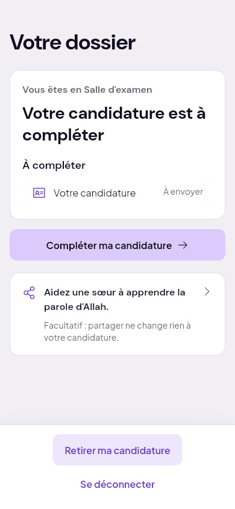
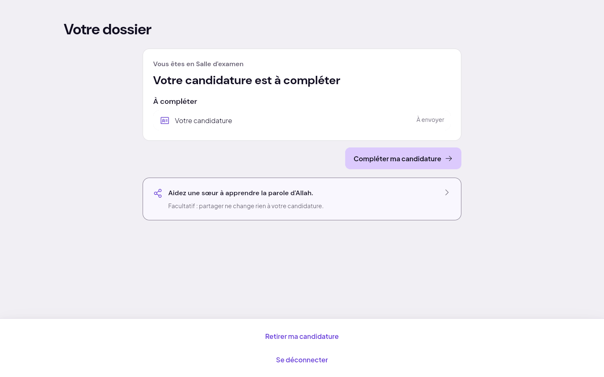
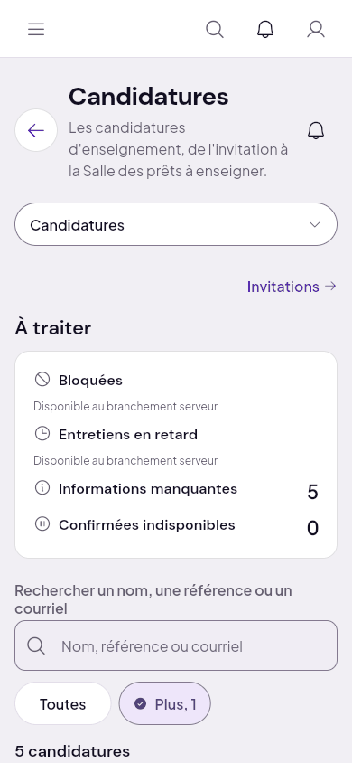
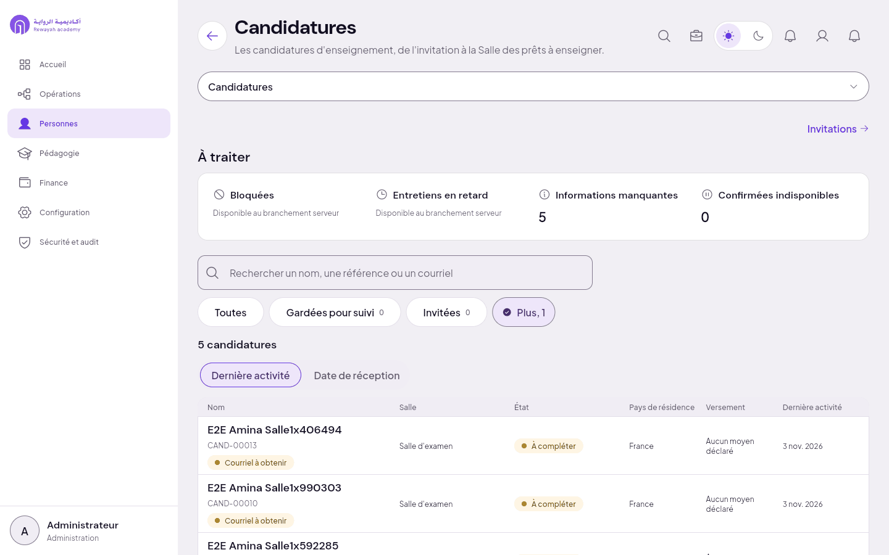
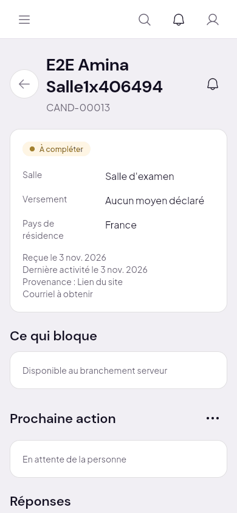
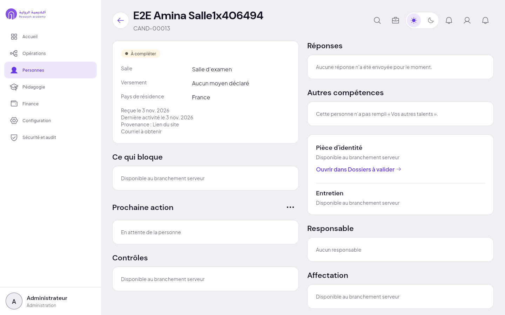

# 1. Salle d'examen

Étape serveur : `prequalification`, état `a_completer`. Candidate amorcée : E2E Amina (voir le
[sommaire](README.md) pour ce que l'amorce prouve ou non).

## Ce que voit la candidate

« Votre dossier », puis « Vous êtes en Salle d'examen » et « Votre candidature est à compléter » ;
à compléter : « Votre candidature », à envoyer ; bouton « Compléter ma candidature ». En bas,
« Retirer ma candidature » et « Se déconnecter ».

| 390 | 1440 |
| :--- | :--- |
|  |  |

## Ce que voit la direction

Personnes › Candidatures, filtre « Salle d'examen » (sous « Plus » au bureau) : la candidate, salle
« Salle d'examen », état « À compléter ». Sa fiche : salle, versement, pays, « Aucune réponse n'a
été envoyée pour le moment », « En attente de la personne ».

| | 390 | 1440 |
| :--- | :--- | :--- |
| Liste filtrée |  |  |
| Fiche |  |  |

## Manques

- Rien de bloquant vu dans cette salle.
- Sur la fiche de la direction, « Ce qui bloque », « Pièce d'identité », « Contrôles » et
  « Affectation » disent « Disponible au branchement serveur ».
