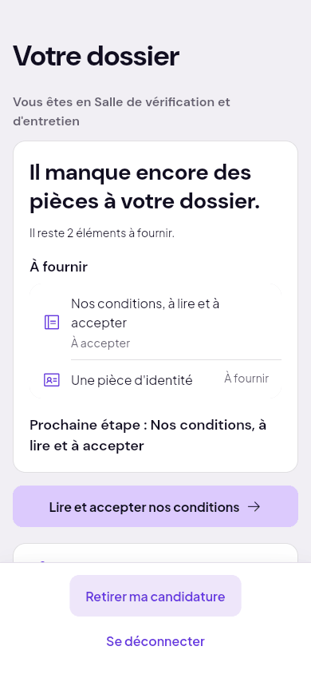
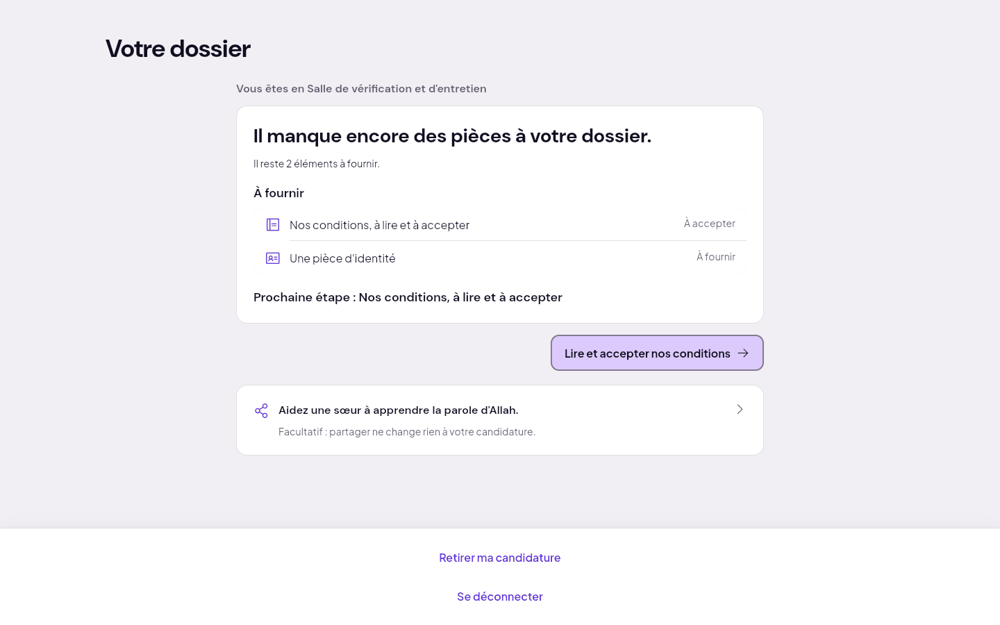
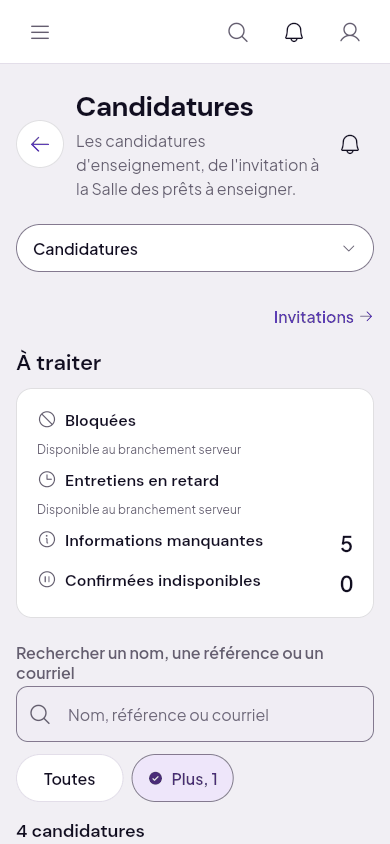
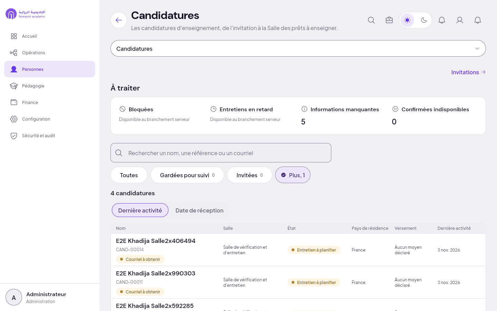
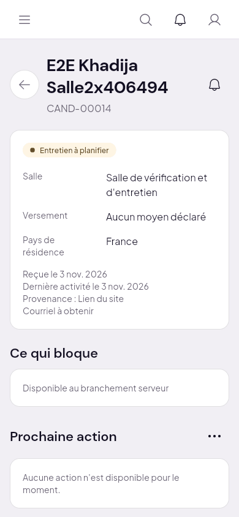
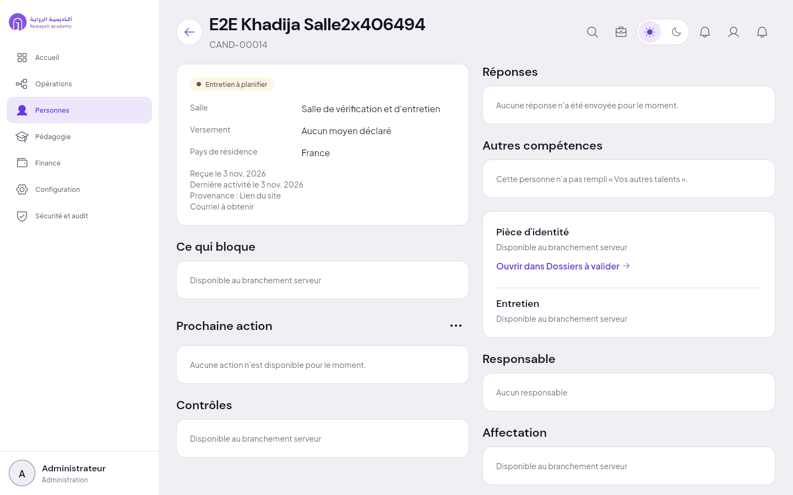

# 2. Salle de vérification et d'entretien

Étape serveur : `verifications`, état `entretien_a_planifier`. Candidate amorcée : E2E Khadija
(voir le [sommaire](README.md) pour ce que l'amorce prouve ou non).

## Ce que voit la candidate

« Vous êtes en Salle de vérification et d'entretien », puis « Il manque encore des pièces à votre
dossier » : nos conditions, à lire et à accepter ; une pièce d'identité, à fournir ; bouton « Lire et
accepter nos conditions ». **Aucun entretien n'est mentionné.**

| 390 | 1440 |
| :--- | :--- |
|  |  |

## Ce que voit la direction

Personnes › Candidatures, filtre « Salle de vérification et d'entretien » : la candidate, état
« Entretien à planifier ». Sa fiche : l'état « Entretien à planifier », et un bloc « Entretien » qui
dit « Disponible au branchement serveur ». « Prochaine action » : « Aucune action n'est disponible
pour le moment ».

| | 390 | 1440 |
| :--- | :--- | :--- |
| Liste filtrée |  |  |
| Fiche |  |  |

## Manques

- **Sans entretien** : la salle porte l'entretien dans son nom, mais personne ne peut le planifier
  ni le tenir. La candidate n'en voit rien ; la direction voit « Entretien à planifier » sans aucun
  geste pour le faire. Lots prévus : V1 (serveur) et V2 (écrans) de la visio d'entretien.
