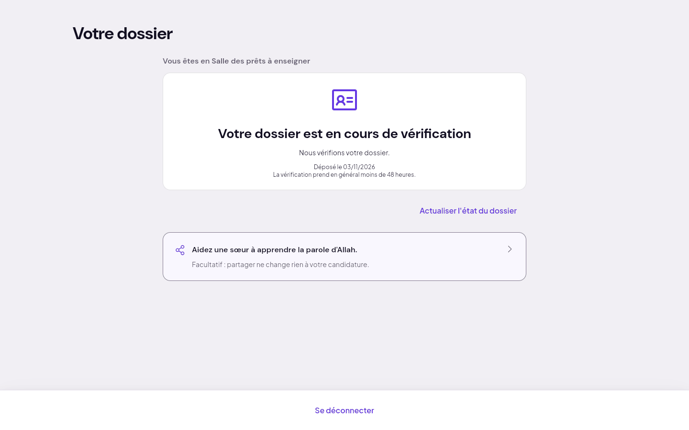
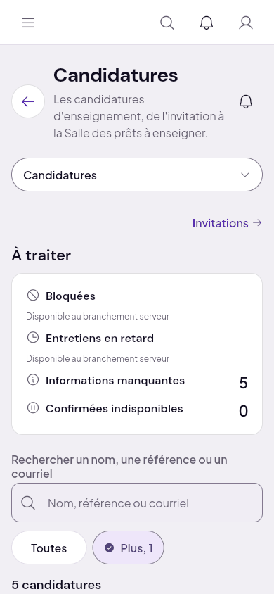
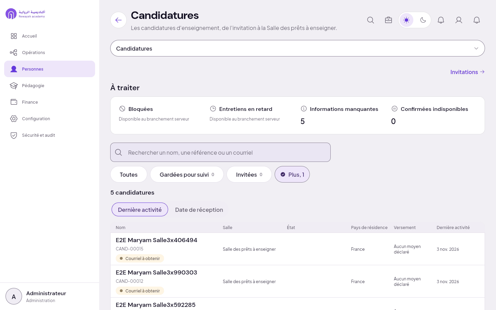
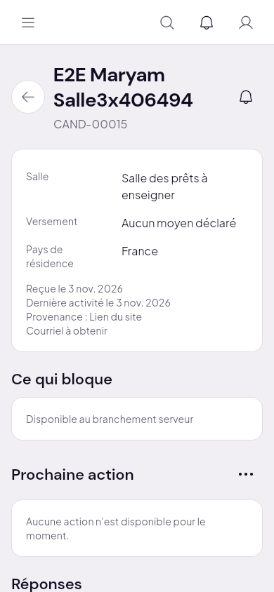
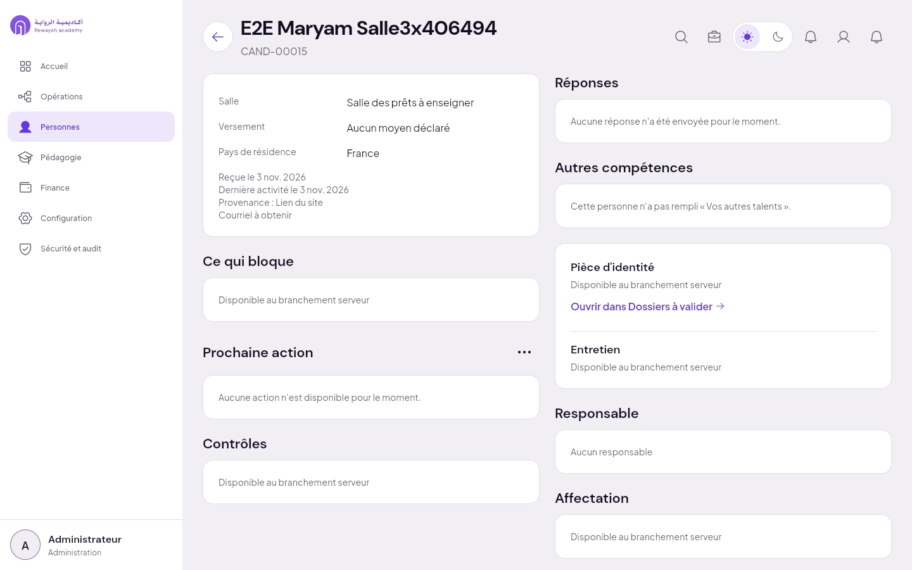

# 3. Salle des prêts à enseigner

Étape serveur : `confirmee`. Candidate amorcée : E2E Maryam, avec ce qu'elle a fait en salle 2 :
pièce d'identité approuvée, accord, accusé et code de conduite signés ; son compte reste en attente
(`pending_kyc`). Voir le [sommaire](README.md) pour ce que l'amorce prouve ou non.

## Ce que voit la candidate

« Vous êtes en Salle des prêts à enseigner », puis **« Votre dossier est en cours de vérification »**,
« Nous vérifions votre dossier », « La vérification prend en général moins de 48 heures » ; lien
« Actualiser l'état du dossier ». Rien ne lui dit qu'elle est prête, ni ce qui vient ensuite.

| 390 | 1440 |
| :--- | :--- |
|  |  |

## Ce que voit la direction

Personnes › Candidatures, filtre « Salle des prêts à enseigner » : la candidate, sans état (la salle
suffit à le dire). Sa fiche : « Prochaine action » : « Aucune action n'est disponible pour le
moment » ; « Affectation » : « Disponible au branchement serveur ».

| | 390 | 1440 |
| :--- | :--- | :--- |
| Liste filtrée |  |  |
| Fiche |  |  |

## Manques

- **Non reliée** : la salle n'est reliée ni à l'écran du candidat (il lit « en cours de
  vérification »), ni à l'activation du compte, ni à l'affectation à une Classe (aucune action côté
  direction, « Affectation » non branchée).
